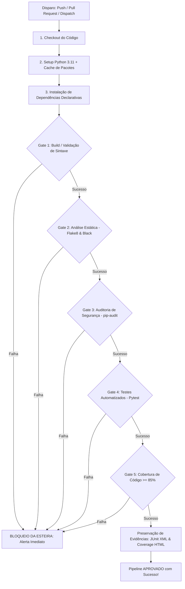

# OrderFlow API — Pipeline de Qualidade, DevOps e QAOps

> **Projeto Prático da Disciplina de Qualidade de Software / DevOps**  
> **Tema:** Automação de Verificações de Qualidade e Bloqueio de Regressões no Fluxo de Entrega Contínua.

---

## 1. Visão Geral do Sistema

O **OrderFlow API** é um microsserviço desenvolvido em **Python** e **FastAPI** voltado ao cálculo de regras de precificação, concessão de cupons de desconto por fidelidade, tarifação de frete logístico por peso e região geográfica, além da gestão do ciclo de vida de pedidos (*Draft*, *Confirmed*, *Cancelled*).

O foco deste projeto não reside na complexidade computacional do sistema, mas sim na **implementação de uma esteira robusta de QAOps (Quality Assurance in DevOps)**, garantindo que alterações inadequadas, quebras de contrato, falhas de segurança em dependências e regressões funcionais sejam detectadas precocemente e bloqueiem a progressão do software em direção à produção.

---

## 2. Estrutura do Repositório

```text
├── .github/
│   └── workflows/
│       └── ci-pipeline.yml         # Definição declarativa do pipeline no GitHub Actions
├── docs/
│   ├── relatorio_tecnico_devops_qaops.md  # Relatório técnico completo (6 a 10 páginas)
│   └── roteiro_apresentacao_defesa.md     # Roteiro guiado para defesa oral (10-12 min)
├── scripts/
│   └── simulate_failure.py         # Utilitário para reproduzir o experimento aprovado/reprovado
├── src/
│   ├── __init__.py                 # Metadados e versão da aplicação (1.0.0)
│   ├── exceptions.py               # Exceções de domínio (OrderNotFoundError, InvalidOrderStateError, etc.)
│   ├── main.py                     # Rotas HTTP REST e tratamento de erros
│   ├── models.py                   # Modelos de dados e validações estruturais com Pydantic
│   └── services.py                 # Regras de negócio, cálculo de descontos, fretes e ciclo de vida
├── tests/
│   ├── __init__.py
│   ├── test_api.py                 # Testes de integração de rotas e contratos HTTP
│   └── test_services.py            # Testes unitários de regras de negócio e cálculo
├── .flake8                         # Configuração de linter PEP8
├── .gitignore                      # Regras de exclusão do controle de versão
├── pyproject.toml                  # Configuração do Pytest (coverage 85%) e Black
├── requirements.txt                # Dependências declarativas de produção
├── requirements-dev.txt            # Dependências declarativas de desenvolvimento e QA
└── README.md                       # Documentação técnica do projeto
```

---

## 3. Instalação e Execução Local

### Pré-requisitos
* Python 3.11 ou superior
* Git instalado

### Passo a Passo

1. **Clonar o repositório:**
   ```bash
   git clone <URL_DO_REPOSITORIO>
   cd T2
   ```

2. **Criar e ativar o ambiente virtual (recomendado):**
   ```bash
   python -m venv .venv
   # Windows (PowerShell):
   .venv\Scripts\Activate.ps1
   # Linux / macOS:
   source .venv/bin/activate
   ```

3. **Instalar dependências de produção e ferramentas de qualidade:**
   ```bash
   pip install --upgrade pip
   pip install -r requirements-dev.txt
   ```

4. **Executar a API localmente:**
   ```bash
   uvicorn src.main:app --reload --port 8000
   ```
   * A documentação interativa OpenAPI/Swagger estará acessível em: `http://localhost:8000/docs`
   * Health Check: `http://localhost:8000/health`

---

## 4. Execução Manual dos Testes e Verificações

Cada verificação pode ser executada isoladamente ou em lote localmente pelo desenvolvedor antes de realizar o `push`:

```bash
# 1. Validação de Build e Compilação prévia
python -m compileall src

# 2. Formatação com Black e Linter com Flake8
black --check src tests
flake8 src tests

# 3. Auditoria de Segurança de Dependências (SAST de pacotes)
pip-audit -r requirements.txt --desc on

# 4. Execução de Testes com Relatório de Cobertura (Threshold >= 85%)
pytest
```

---

## 5. Arquitetura do Pipeline de CI/CD (GitHub Actions)

O pipeline `.github/workflows/ci-pipeline.yml` é disparado automaticamente a cada evento de `push` ou `pull_request` direcionado ao branch `main`, ou manualmente via `workflow_dispatch`.



---

## 6. Fichas dos Quality Gates

| Gate | Critério Objetivo | Risco Controlado | Momento | Evidência Gerada | Consequência da Falha |
|---|---|---|---|---|---|
| **Gate 1: Build & Sintaxe** | `python -m compileall src` sem erro de sintaxe/importação | Código que não inicializa ou quebra no boot | Imediato após instalação | Log de compilação de bytecode | Bloqueio imediato |
| **Gate 2: Análise Estática** | Zero violações PEP8 (`flake8`) e formatação uniforme (`black`) | Débito técnico, variáveis mortas e código ilegível | Pré-execução dos testes | Relatório de conformidade no console | Bloqueio imediato |
| **Gate 3: Segurança** | Zero CVEs conhecidas nas dependências de produção (`pip-audit`) | Invasões e exploração de brechas conhecidas (OWASP A06) | Pré-testes | Relatório de vulnerabilidades auditadas | Bloqueio e solicitação de patch |
| **Gate 4: Testes Automatizados** | 100% de sucesso em testes unitários e de integração (19 testes) | Regressão de regras de negócio, cálculo incorreto de frete/desconto | Execução de testes | Relatório JUnit XML (`test-reports/junit.xml`) | Bloqueio imediato |
| **Gate 5: Cobertura de Código** | Cobertura total das linhas de `src/` superior a 85% (alcançado: 100%) | Lógica obscura e sem verificação automatizada | Pós-testes | Relatório XML/HTML (`test-reports/coverage_html`) | Bloqueio da esteira |

---

## 7. Procedimento do Experimento Obrigatório

O trabalho acadêmico exige a demonstração de: (1) um cenário aprovado, (2) um cenário reprovado controlado e (3) a correção com nova aprovação.

Para facilitar e agilizar os testes, foi desenvolvido o script `scripts/simulate_failure.py`.

### Cenário 1: Execução Aprovada
1. Certifique-se de que o repositório está no estado padrão limpo.
2. Execute localmente ou envie para o GitHub:
   ```bash
   pytest
   git push origin main
   ```
3. **Resultado:** Todos os 5 Quality Gates são aprovados com sinal verde (`✓`).

### Cenário 2: Execução Reprovada (Falha Controlada)
1. Injete uma regressão intencional no cálculo do subtotal da regra de negócio:
   ```bash
   python scripts/simulate_failure.py --cause test
   ```
2. Realize o commit e envie a alteração para disparar o pipeline:
   ```bash
   git add src/services.py
   git commit -m "feat: alteracao experimental para validar bloqueio do pipeline"
   git push origin main
   ```
3. **Resultado:** O pipeline é interrompido no **Quality Gate 4 (Testes Automatizados)**. A alteração indevida é barrada antes de qualquer possibilidade de deploy.

### Cenário 3: Correção e Restauração do Pipeline
1. Reverta a alteração indevida:
   ```bash
   python scripts/simulate_failure.py --revert
   ```
2. Realize o commit da correção:
   ```bash
   git add src/services.py
   git commit -m "fix: restaurada a regra correta de calculo do subtotal"
   git push origin main
   ```
3. **Resultado:** O pipeline volta a rodar com sucesso, registrando o histórico de auditoria completo.

---

## 8. Relatório Técnico e Roteiro de Apresentação

* O relatório técnico formal de acordo com as exigências de 6 a 10 páginas da disciplina encontra-se disponível em: [`docs/relatorio_tecnico_devops_qaops.md`](file:///c:/Users/gleis/OneDrive/Desktop/T2/docs/relatorio_tecnico_devops_qaops.md)
* O guia com falas e minutagem para a apresentação de 10 a 12 minutos encontra-se em: [`docs/roteiro_apresentacao_defesa.md`](file:///c:/Users/gleis/OneDrive/Desktop/T2/docs/roteiro_apresentacao_defesa.md)
