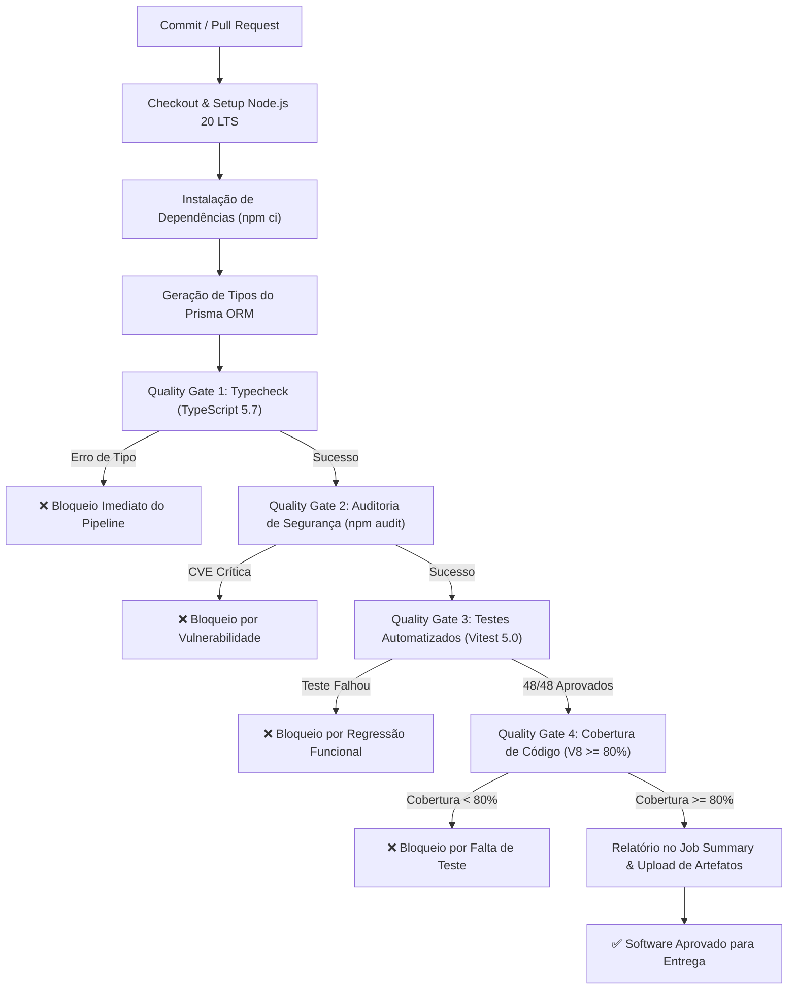

# Gusto — Pipeline de Qualidade, DevOps e QAOps

> **Projeto Prático da Disciplina de Qualidade de Software / DevOps**  
> **Tema:** Automação de Verificações de Qualidade, Quality Gates e Bloqueio de Regressões no Fluxo de Entrega Contínua.  
> **Aplicação sob Teste:** **Gusto** (Plataforma de Receitas Culinárias com Foco no Microsserviço de Backend em Node.js / TypeScript / Next.js).

---

## 1. Visão Geral do Sistema

O **Gusto** é uma plataforma moderna e minimalista para descoberta, curadoria e compartilhamento de receitas culinárias. O projeto adota uma arquitetura em **monorepo**, composta por:

1. **Backend (Microsserviço de API REST):** Desenvolvido em **Next.js 15**, **TypeScript**, **Prisma ORM** e **PostgreSQL**. É responsável por regras de negócio sensíveis, incluindo:
   * **Autenticação e Sessões:** Criptografia de senhas com bcrypt (12 salt rounds), emissão de tokens JWT de acesso (15 min) e rotação de Refresh Tokens (30 dias) com mecanismo anti-reuso (purga de sessões comprometidas).
   * **Recuperação de Senha com OTP:** Geração determinística de códigos de verificação de 6 dígitos descartáveis, com expiração em 10 minutos e hashing de segurança.
   * **Proteção contra Abuso (Rate Limiting):** Limitador de taxa em memória por endereço IP (`x-forwarded-for` / `x-real-ip`) para mitigar ataques de força bruta em rotas críticas de login e redefinição de credenciais.
   * **Normalização TheMealDB:** Mecanismo de tradução e conversão de receitas externas, transformando frações culinárias imperfeitas (`1/2 cup`, `1 1/2 tbsp`), unidades de medida e ingredientes em entidades estruturadas em português brasileiro.
   * **Validação de Domínio:** Schemas estritos com **Zod** para inserção de receitas, ingredientes e passos de preparo.

2. **Android App (Cliente Mobile):** Desenvolvido nativamente em **Kotlin** e **Jetpack Compose** com Material 3, tema OLED True Black (#000000) e arquitetura MVVM/Clean.

---

## 2. Estrutura do Repositório

```text
T2/
├── .github/
│   └── workflows/
│       └── ci-pipeline.yml         # Pipeline declarativo no GitHub Actions (QAOps)
├── backend/                        # Backend sob teste (Next.js 15 + Prisma + Vitest)
│   ├── prisma/
│   │   ├── schema.prisma           # Modelagem de dados relacional
│   │   └── seed.ts                 # Carga de dados inicial
│   ├── src/
│   │   ├── app/api/                # Rotas HTTP REST (Auth, Recipes, Fridge, etc.)
│   │   │   ├── auth/               # Register, Login, Refresh, Forgot-Password, Reset-Password
│   │   │   └── recipes/            # CRUD e catálogo unificado de receitas
│   │   └── lib/                    # Regras de negócio, segurança e utilitários
│   │       ├── auth.ts             # Criptografia, JWT, rotação e OTP
│   │       ├── email.ts            # Provedor de e-mail transacional
│   │       ├── mealdb.ts           # Normalizador e tradutor de dados
│   │       ├── prisma.ts           # Singleton Prisma Client com Connection Pooling
│   │       └── rate-limit.ts       # Rate Limiter em memória por IP
│   ├── tests/                      # Suíte de testes automatizados com Vitest
│   │   ├── auth.test.ts            # Testes unitários de auth, hash, tokens e OTP
│   │   ├── rate-limit.test.ts      # Testes de rate limiting e proteção anti-abuso
│   │   ├── mealdb.test.ts          # Testes de parser de medidas e traduções
│   │   ├── api-auth.test.ts        # Testes de integração de rotas de autenticação
│   │   └── recipes.test.ts         # Testes de rotas de catálogo e criação de receitas
│   ├── package.json                # Dependências e scripts de execução/QA
│   ├── tsconfig.json               # Configurações do compilador TypeScript
│   └── vitest.config.mts           # Configuração de testes e cobertura (thresholds)
├── android/                        # Aplicativo nativo Android (Kotlin + Jetpack Compose)
├── docs/
│   ├── relatorio_tecnico_devops_qaops.md  # Relatório técnico completo (seções 1 a 9)
│   └── roteiro_apresentacao_defesa.md     # Roteiro guiado para defesa oral (10-12 min)
├── scripts/
│   └── simulate_failure.js         # Utilitário para reprodução de experimento aprovado/reprovado
├── package.json                    # Scripts auxiliares para execução na raiz
└── README.md                       # Documentação técnica do projeto
```

---

## 3. Arquitetura do Pipeline de QAOps

O pipeline de Integração Contínua foi estruturado na esteira do **GitHub Actions** seguindo os princípios de *fail-fast*, feedback contínuo e geração sistemática de evidências.



---

## 4. Matriz de Quality Gates

| Gate | Ferramenta | Critério Objetivo de Aprovação | Risco Mitigado | Consequência |
| :--- | :--- | :--- | :--- | :--- |
| **Gate 1: Build / Typecheck** | `tsc --noEmit` | Zero erros de tipagem estática e compilação | Código com quebra de contrato sintático ou tipos incompatíveis | **Bloqueio Total** |
| **Gate 2: Segurança de Dependências** | `npm audit` | Zero vulnerabilidades de severidade crítica | Invasão e comprometimento por supply-chain attacks conhecidos | **Bloqueio Total** |
| **Gate 3: Testes Automatizados** | `vitest run` | 100% dos testes unitários e de rotas aprovados (48 testes) | Regressões funcionais em autenticação, OTP, rate limit e receitas | **Bloqueio Total** |
| **Gate 4: Cobertura Mínima de Código** | `@vitest/coverage-v8` | Cobertura >= 80% de Linhas, Instruções e Funções nos módulos críticos | Áreas sensíveis de negócio alteradas sem validação automatizada | **Bloqueio Total** |

---

## 5. Instruções de Instalação e Execução Local

### Pré-requisitos
* **Node.js** v20.x ou v22.x LTS instalado.
* **Git** instalado.

### Passo a Passo

1. **Instalar as dependências do backend:**
   ```bash
   cd backend
   npm install
   ```

2. **Gerar os tipos do Prisma Client:**
   ```bash
   npx prisma generate
   ```

3. **Executar a validação completa de QAOps localmente (Typecheck + Cobertura):**
   ```bash
   npm run qa
   ```

4. **Executar os testes automatizados individualmente:**
   ```bash
   # Execução rápida de todos os testes
   npm test

   # Execução com relatório detalhado de cobertura (LCOV, HTML e Terminal)
   npm run test:coverage

   # Verificação estática de tipos
   npm run typecheck
   ```

---

## 6. Experimento Obrigatório: Cenário Aprovado vs. Reprovado

Para validar a eficácia dos *Quality Gates* em bloquear alterações defeituosas no fluxo contínuo, foi construído o script de automação [`scripts/simulate_failure.js`](file:///C:/Users/gleis/OneDrive/Desktop/T2/scripts/simulate_failure.js).

### Procedimento Experimental

1. **Cenário 1 — Execução Aprovada (Baseline de Qualidade):**
   ```bash
   npm test
   # Resultado: 48 testes passam com sucesso (100%), cobertura acima de 86%.
   ```

2. **Cenário 2 — Injeção de Falha Funcional Deliberada (Regressão de Negócio):**
   ```bash
   node scripts/simulate_failure.js --inject-test-failure
   npm test
   # Resultado: O teste de segurança de OTP falha, interrompendo a esteira e bloqueando o avanço.
   ```

3. **Cenário 3 — Injeção de Falha de Tipagem (Quebra de Contrato Estático):**
   ```bash
   node scripts/simulate_failure.js --inject-type-failure
   npm --prefix backend run typecheck
   # Resultado: O Quality Gate 1 falha imediatamente na fase de checagem estática antes dos testes.
   ```

4. **Cenário 4 — Correção e Restauração (Re-execução Aprovada):**
   ```bash
   node scripts/simulate_failure.js --revert
   npm test
   # Resultado: Código restaurado ao estado íntegro, todos os gates voltam a ficar verdes.
   ```

---

## 7. Documentação Técnica da Disciplina

* 📄 **[Relatório Técnico Completo de DevOps e QAOps](file:///C:/Users/gleis/OneDrive/Desktop/T2/docs/relatorio_tecnico_devops_qaops.md)**: Documento aprofundado cobrindo as 9 seções obrigatórias (Identificação, Contexto, Riscos, Pipeline, Testes, Quality Gates, Experimento, Análise Crítica e Contribuições).
* 🎤 **[Roteiro de Apresentação e Defesa Oral](file:///C:/Users/gleis/OneDrive/Desktop/T2/docs/roteiro_apresentacao_defesa.md)**: Estrutura cronometrada (10 a 12 minutos) com divisão de falas da dupla e respostas para a banca avaliadora.
