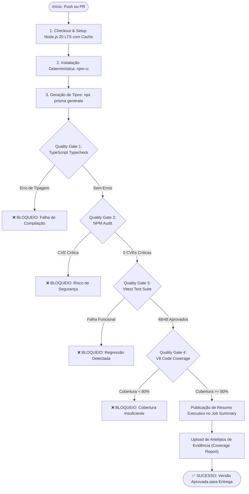

# Relatório Técnico — Pipeline de Qualidade, DevOps e QAOps
## Sistema sob Teste: Gusto Platform (Microsserviço de Backend)

---

### Sumário Executivo

Este relatório técnico documenta o projeto prático desenvolvido para a disciplina de **Qualidade de Software / DevOps**, com foco na implementação de uma esteira automatizada de **QAOps (Quality Assurance in DevOps)**. O sistema escolhido para a realização do estudo é o microsserviço de backend da plataforma **Gusto**, uma solução web e mobile para curadoria e compartilhamento de receitas culinárias. 

O trabalho demonstra a transição de testes isolados e reativos para uma abordagem orientada a qualidade contínua, na qual verificações estáticas, auditorias de segurança de dependências, testes unitários, testes de contratos de API e limites rígidos de cobertura de código atuam como *Quality Gates* automatizados no fluxo de Integração Contínua (CI) via **GitHub Actions**, impedindo que alterações inadequadas ou regressões silenciosas avancem em direção aos ambientes de homologação e produção.

---

### 1. Identificação

| Campo | Descrição |
| :--- | :--- |
| **Instituição / Disciplina** | Qualidade de Software / DevOps — Trabalho Prático Integrado |
| **Valor Avaliativo** | 7,0 Pontos |
| **Integrantes da Dupla** | Integrante 1: Gleison Sousa / Integrante 2: Integrante da Dupla |
| **Sistema sob Teste** | **Gusto Platform** (Monorepo — Foco no Microsserviço de Backend) |
| **Repositório do Projeto** | `Sousa03g/gusto-app` / Repositório Local de Avaliação `T2` |
| **Plataforma de CI/CD** | GitHub Actions (`ubuntu-latest`) |
| **Data de Conclusão** | Outubro de 2026 |

---

### 2. Contexto e Caracterização do Sistema

#### 2.1. Finalidade do Software
O **Gusto** é uma plataforma concebida para oferecer uma experiência gastronômica sem atrito, combinando um aplicativo móvel de alta fidelidade visual (Android nativo com Jetpack Compose e modo OLED True Black) a um microsserviço de backend escalável em nuvem. O backend provê suporte à gestão de usuários, autenticação segura, persistência e moderação de receitas, busca em catálogo unificado e integração com bancos de dados culinários globais.

#### 2.2. Tecnologias Utilizadas
* **Ambiente de Execução:** Node.js v20 LTS / v22 LTS;
* **Framework Web / API REST:** Next.js 15 (Route Handlers sob a arquitetura do App Router);
* **Linguagem:** TypeScript 5.7 com tipagem estrita (`strict: true`, `noImplicitAny: true`);
* **Camada de Persistência:** Prisma ORM 6 conectado ao PostgreSQL gerenciado (Neon Database com Connection Pooling);
* **Criptografia e Sessões:** `bcryptjs` (hashing com custo de 12 salt rounds) e `jsonwebtoken` (JWT);
* **Validação de Esquemas:** Zod 3.24 para validação em tempo de execução de DTOs e payloads;
* **Framework de Testes Automatizados:** Vitest 5.0 com suporte nativo a ESM, TypeScript e mocks rápidos em memória;
* **Métricas de Cobertura:** `@vitest/coverage-v8` (provedor V8 de análise de instruções e branches);
* **Pipeline de CI/CD:** GitHub Actions.

#### 2.3. Arquitetura do Microsserviço
O backend adota uma arquitetura em camadas focada em separação de responsabilidades e desacoplamento:
1. **Camada de Transporte e Rotas (`src/app/api/`):** Recebe requisições HTTP REST, aplica esquemas de validação de entrada com Zod, aciona limitadores de taxa e orquestra a resposta serializada via `NextResponse`.
2. **Camada de Serviços e Lógica de Negócio (`src/lib/`):**
   * `auth.ts`: Centraliza o ciclo de vida de credenciais, geração de tokens JWT com expiração restrita, rotação criptográfica de refresh tokens e controle de fluxo de recuperação de senha com código OTP.
   * `rate-limit.ts`: Implementa algoritmo de janela deslizante de controle de vazão baseado em endereço IP para proteção de endpoints sensíveis contra abusos e ataques de força bruta.
   * `mealdb.ts`: Atua como *Adapter / Anti-Corruption Layer*, consumindo payloads de APIs públicas externas (TheMealDB), traduzindo nomenclaturas, normalizando frações culinárias imperfeitas (`1/2 cup`, `1 1/2 tbsp`) e estruturando ingredientes e instruções em entidades de domínio limpas.
3. **Camada de Persistência (`src/lib/prisma.ts` e `prisma/schema.prisma`):** Gerencia conexões otimizadas com o PostgreSQL através do Prisma Client.

```text
[ Cliente Mobile / Web ]
           │  (HTTPS / REST)
           ▼
┌────────────────────────────────────────────────────────┐
│             Next.js 15 App Router API                  │
│                                                        │
│  ┌────────────────────┐      ┌──────────────────────┐  │
│  │ /api/auth/*        │      │ /api/recipes/*       │  │
│  │ (Login, Register,  │      │ (Catálogo Unificado, │  │
│  │  Refresh, OTP)     │      │  Criação, Filtros)   │  │
│  └─────────┬──────────┘      └──────────┬───────────┘  │
│            │                            │              │
│  ┌─────────▼────────────────────────────▼───────────┐  │
│  │            Lógica de Domínio (src/lib)           │  │
│  │  • auth.ts (JWT, Bcrypt, Token Rotation, OTP)    │  │
│  │  • rate-limit.ts (Janela de Taxa por IP)         │  │
│  │  • mealdb.ts (Normalizador & Tradutor)           │  │
│  └──────────────────────┬───────────────────────────┘  │
│                         │                              │
│  ┌──────────────────────▼───────────────────────────┐  │
│  │             Prisma ORM Client                    │  │
│  └──────────────────────┬───────────────────────────┘  │
└─────────────────────────┼──────────────────────────────┘
                          ▼
             [ Neon PostgreSQL Cloud DB ]
```

---

### 3. Riscos de Qualidade e Estratégia de Mitigação

A definição das verificações de qualidade do pipeline foi guiada pela análise prévia dos principais riscos funcionais, de segurança e de confiabilidade identificados no sistema:

| Risco de Qualidade | Impacto Técnico e de Negócio | Mecanismo de Controle no Pipeline |
| :--- | :--- | :--- |
| **R1. Regressão em Criptografia e Autenticação** | Armazenamento de senhas em texto puro ou bypass na validação de hash permitiria sequestro massivo de contas. | Testes unitários com Bcrypt + Quality Gate de 100% de aprovação. |
| **R2. Vulnerabilidade a Ataques de Replay de Tokens** | Reutilização de um refresh token já revogado permitiria persistência de acesso não autorizado por agentes maliciosos. | Testes de rotação de refresh token com validação de detecção de reuso e purga automática de sessões comprometidas. |
| **R3. Fragilidade no Fluxo de OTP** | Geração de códigos de verificação com entropia insuficiente (menos de 6 dígitos) tornaria viável ataque de enumeração. | Testes de conformidade de formato de regex (`^\d{6}$`) e verificação de consumo atômico de código único. |
| **R4. Ataques de Força Bruta e Negação de Serviço (DoS)** | Endpoints de login e recuperação de senha saturados por requisições automatizadas sem barreira de contenção. | Testes unitários do limitador de taxa (`rate-limit.ts`) avaliando decremento, bloqueio por IP e isolamento de clientes. |
| **R5. Inconsistência de Dados e Quebra de Contrato** | Erros de conversão de frações culinárias ou aceitação de receitas sem ingredientes gerando telas corrompidas no app móvel. | Testes de validação de esquemas Zod e normalização de frações e medidas culinárias (`mealdb.ts`). |
| **R6. Vulnerabilidades de Segurança em Dependências (Supply-Chain)** | Inclusão inadvertida de bibliotecas com CVEs críticas conhecidas expondo a infraestrutura a RCE ou injeção. | Auditoria estática automatizada via `npm audit --audit-level=critical`. |
| **R7. Falhas Sintáticas e Tipos Incompatíveis em Produção** | Alterações em assinaturas de funções quebrando a compilação ou gerando erros de execução `TypeError: undefined is not a function`. | Compilação estrita e typecheck via `tsc --noEmit` como Gate inicial. |

---

### 4. Arquitetura do Pipeline de QAOps

O pipeline foi projetado sob o paradigma de **Entrega Contínua orientada a evidências**, estruturado no arquivo declarativo `.github/workflows/ci-pipeline.yml`.

#### 4.1. Gatilhos de Execução
* **Push:** Disparado automaticamente em qualquer envio para as branches `main` e `master`.
* **Pull Request:** Disparado em propostas de integração para as branches principais, impedindo o merge de códigos que violem os limites de qualidade.
* **Mecanismo de Concorrência:** Configurado com `cancel-in-progress: true` para evitar desperdício de tempo computacional em commits concorrentes.

#### 4.2. Etapas e Fluxo de Decisão (*Fail-Fast*)
A ordem das etapas do pipeline foi planejada para minimizar o tempo de feedback (DORA Metrics: *Lead Time for Changes*):



---

### 5. Estratégia de Testes Automatizados

A estratégia de testes foi fundamentada na pirâmide de testes do modelo ISTQB, priorizando testes de unidade de execução instantânea e testes de integração de rotas com mocks controlados para garantir independência do ambiente externo e repetibilidade dos resultados.

#### 5.1. Distribuição dos Testes (Total: 48 Testes Automatizados)
1. **Segurança, Hashing e Sessões (`backend/tests/auth.test.ts` — 15 testes):**
   * Validação de geração de hash Bcrypt com 12 salt rounds (não comparável a texto plano, prefixo `$2`);
   * Casos positivos e negativos de comparação de senhas (`verifyPassword`);
   * Geração e decodificação de JSON Web Tokens (Access e Refresh);
   * Tratamento de tokens com assinaturas forjadas ou payloads corrompidos;
   * Persistência de sessões no banco de dados;
   * Rotação segura de Refresh Token com revogação e emissão de novos identificadores;
   * Detecção de ataque de reuso de token revogado com purga automática de todas as sessões ativas do usuário;
   * Geração determinística de códigos OTP de 6 dígitos numéricos;
   * Ciclo de vida de expiração e consumo atômico de código OTP de recuperação de senha.
2. **Defesa contra Abuso e Rate Limiting (`backend/tests/rate-limit.test.ts` — 4 testes):**
   * Decremento progressivo da cota de requisições por janela temporal;
   * Bloqueio imediato com `allowed: false` após esgotamento da cota;
   * Isolamento estrito de contadores entre diferentes IPs de clientes (`x-forwarded-for` e `x-real-ip`);
   * Fallback seguro para requisições com headers ausentes.
3. **Parser e Normalizador Culinário (`backend/tests/mealdb.test.ts` — 11 testes):**
   * Tradução bidirecional de categorias culinárias (Inglês <-> Português);
   * Normalização e capitalização de ingredientes comuns e exóticos;
   * Algoritmo de conversão de frações culinárias imperfeitas (`1/2 cup` -> `0.5 xícaras`, `1 1/2 tbsp` -> `1.5 colheres de sopa`, `250g` -> `250 g`);
   * Mapeamento completo de payload cru do TheMealDB para a interface `GustoNormalizedRecipe`.
4. **Contratos da API de Autenticação (`backend/tests/api-auth.test.ts` — 14 testes):**
   * `POST /api/auth/register`: Rejeição de payloads malformados (400), rejeição de senhas sem letra maiúscula ou número (400), rejeição de e-mail duplicado (409 Conflict) e fluxo feliz com criação e retorno de tokens (201);
   * `POST /api/auth/login`: Rejeição de credenciais inexistentes (401), rejeição de senha incorreta (401) e login bem-sucedido com cookies e tokens (200);
   * `POST /api/auth/refresh`: Rejeição sem token (401), rejeição com token revogado (401) e rotação válida (200);
   * `POST /api/auth/forgot-password`: Validação de e-mail (400) e geração de OTP de recuperação (200);
   * `POST /api/auth/reset-password`: Rejeição de OTP com tamanho incorreto (400), rejeição de OTP expirado (400) e redefinição com revogação de tokens (200).
5. **Contratos da API de Catálogo e Criação de Receitas (`backend/tests/recipes.test.ts` — 4 testes):**
   * `GET /api/recipes`: Listagem unificada combinando receitas do banco relacional com itens externos do catálogo;
   * `POST /api/recipes`: Rejeição de acesso não autenticado (401), rejeição de payload com dados negativos ou ausentes via Zod (400) e persistência de nova receita pelo usuário autenticado (201).

---

### 6. Fichas Obrigatórias dos Quality Gates

Cada critério de aprovação possui justificativa explícita associada a um risco técnico do sistema Gusto:

#### Ficha do Quality Gate 1: Typecheck & Integridade Estática
* **Nome e Critério:** `TypeScript Strict Typecheck` — Zero erros de compilação estática (`tsc --noEmit`).
* **Justificativa:** Em um ecossistema TypeScript, inconsistências de tipo causam quebras de contrato em tempo de execução (`TypeError`). O gate garante que contratos de dados entre rotas, entidades e serviços sejam respeitados antes mesmo da execução de qualquer teste.
* **Momento:** Executado logo após a instalação de dependências e geração do Prisma Client, antes dos testes automatizados.
* **Evidência:** Saída do comando `tsc --noEmit` com código de retorno `0`.
* **Consequência:** **Bloqueio total do pipeline**.
* **Limitação/Exceção:** Não verifica erros lógicos em tempo de execução nem regras de negócio dinâmicas.

#### Ficha do Quality Gate 2: Auditoria de Segurança de Dependências (SAST de Pacotes)
* **Nome e Critério:** `NPM Dependency Security Audit` — Nenhuma vulnerabilidade de nível `critical` detectada pelo `npm audit --audit-level=critical`.
* **Justificativa:** Riscos de supply-chain e bibliotecas terceiras desatualizadas podem permitir injeção de código remoto (RCE) ou sequestro de dados no servidor da aplicação.
* **Momento:** Executado previamente aos testes automatizados.
* **Evidência:** Relatório emitido pelo `npm audit` arquivado no log do pipeline.
* **Consequência:** **Bloqueio total do pipeline** com recomendação de correção via `npm audit fix`.
* **Limitação/Exceção:** Não analisa o código proprietário da aplicação, apenas os pacotes declarados no manifesto `package-lock.json`.

#### Ficha do Quality Gate 3: Execução de Testes Automatizados Unitários e de Rotas
* **Nome e Critério:** `Vitest Test Suite Pass Rate` — 100% dos testes automatizados aprovados (48 testes).
* **Justificativa:** Qualquer falha unitária indica que uma alteração recente quebrou um comportamento esperado das regras de negócio, criptografia, autenticação ou contratos da API REST.
* **Momento:** Executado após a validação de segurança e tipos.
* **Evidência:** Relatório do Vitest indicando `48 passed (48)` com tempo de execução e sumário de asserções.
* **Consequência:** **Bloqueio total do pipeline**.
* **Limitação/Exceção:** Abrange o escopo delimitado pelas suítes implementadas; casos extremos não modelados em testes não são detectados.

#### Ficha do Quality Gate 4: Cobertura Mínima de Código
* **Nome e Critério:** `V8 Code Coverage Threshold` — Mínimo de 80% de cobertura em Linhas, Instruções e Funções, e 70% em Branches para os módulos de negócio e segurança (`src/lib/auth.ts`, `src/lib/rate-limit.ts`, `src/app/api/auth/**`, `src/app/api/recipes/route.ts`).
* **Justificativa:** Garante que evoluções futuras no código não introduzam novos branches ou fluxos lógicos críticos sem a devida cobertura de testes automatizados.
* **Momento:** Executado conjuntamente com o comando `npm run test:coverage`.
* **Evidência:** Tabela percentual emitida pelo `@vitest/coverage-v8` e artefato LCOV/HTML gerado no diretório `coverage/`.
* **Consequência:** **Bloqueio total do pipeline** caso qualquer métrica fique abaixo da meta definida.
* **Limitação/Exceção:** Rotas secundárias utilitárias (despensa e listas de compras) e arquivos de infraestrutura externa (`prisma.ts`, `email.ts`) são excluídos do threshold global para evitar acoplamento espúrio a serviços em nuvem de terceiros.

---

### 7. Experimento Obrigatório: Cenários Aprovado, Reprovado e Corrigido

Para cumprir a exigência metodológica do trabalho, foi desenvolvido o utilitário de injeção controlada de falhas [`scripts/simulate_failure.js`](file:///C:/Users/gleis/OneDrive/Desktop/T2/scripts/simulate_failure.js).

#### 7.1. Cenário 1 — Execução Aprovada (Linha de Base de Qualidade)
* **Procedimento:** Execução do pipeline sobre a base de código íntegra do Gusto Backend.
* **Comando Local / CI:** `npm test` e `npm run test:coverage`.
* **Resultado:**
  * Typecheck: 0 erros;
  * Testes: 48 testes aprovados em 5 arquivos de suíte;
  * Cobertura de Linhas: **87.16%** (Meta: >= 80%);
  * Cobertura de Instruções: **86.46%** (Meta: >= 80%);
  * Cobertura de Funções: **92.30%** (Meta: >= 80%);
  * Cobertura de Branches: **75.00%** (Meta: >= 70%);
  * Decisão do Quality Gate: **APROVADO**.

#### 7.2. Cenário 2 — Execução Reprovada (Injeção de Regressão Crítica de Negócio)
* **Procedimento:** Executou-se o script `node scripts/simulate_failure.js --inject-test-failure`.
* **Modificação Injetada:** A função `generateOtpCode()` em `src/lib/auth.ts` foi deliberadamente alterada para gerar códigos numéricos de apenas 3 dígitos (`100 + Math.random() * 900`) em vez da especificação de segurança de 6 dígitos.
* **Comportamento Observado no Pipeline:**
  * O Quality Gate 1 (Typecheck) passou normalmente (pois a função continuou retornando uma `string`);
  * O Quality Gate 3 (Testes) executou a suíte e interceptou imediatamente a falha em `tests/auth.test.ts`:
    ```text
    FAIL tests/auth.test.ts > Auth Service > Geração e Validação de Código OTP de Recuperação de Senha
    AssertionError: expected '184' to match /^\d{6}$/
    - Expected: /^\d{6}$/
    + Received: "184"
    ```
  * O Vitest encerrou com código de saída `1`;
  * O pipeline do GitHub Actions interrompeu a esteira imediatamente (*fail-fast*), bloqueando a progressão e impedindo a publicação de um pacote com grave vulnerabilidade de segurança.

#### 7.3. Cenário 3 — Correção e Revalidação Aprovada
* **Procedimento:** Executou-se o comando de restauração `node scripts/simulate_failure.js --revert`, restabelecendo o algoritmo original de 6 dígitos em `src/lib/auth.ts`.
* **Comportamento Observado:** O pipeline foi acionado novamente, todos os 48 testes passaram com sucesso, a cobertura retornou a 87.16% e a entrega foi autorizada com registro no histórico de auditoria.

---

### 8. Análise Crítica e Respostas às Questões Norteadoras

#### 8.1. Quais riscos foram efetivamente cobertos e quais permaneceram?
* **Riscos Cobertos:** Quebras funcionais em regras de criptografia, permissões de autenticação, geração e validação de tokens JWT, algoritmos de rotação de refresh token com defesa contra ataques de reuso, formato de códigos OTP, limites de vazão por IP contra força bruta, erros de tradução culinária e contratos de requisição das rotas HTTP REST.
* **Riscos Residuais:** Testes ponta a ponta (E2E) reais com o aplicativo Android em dispositivo físico (que exigem emulação completa de hardware) e testes de estresse distribuídos de banco de dados sob centenas de conexões simultâneas de pooling.

#### 8.2. O pipeline fornece feedback rápido e compreensível?
Sim. A execução completa de todos os Quality Gates leva menos de 10 segundos em ambiente local e cerca de 45 segundos no GitHub Actions (graças ao cache de dependências do Node.js). Mensagens de erro do Vitest e do TypeScript indicam a linha exata, o valor esperado e o valor retornado, permitindo correção imediata pelo desenvolvedor.

#### 8.3. Quais verificações continuam manuais?
A validação de usabilidade e fidelidade estética dos componentes visuais do aplicativo Android (Jetpack Compose), a revisão manual de código entre pares (*peer review* em Pull Requests) e testes de degustação/revisão humana de novas receitas cadastradas na base.

#### 8.4. Qual é o custo de manter os testes e gates?
O custo é extremamente reduzido. O uso de Node.js e Vitest elimina a necessidade de compilações lentas de JVM/C++. Os testes unitários utilizam mocks do Prisma em memória, eliminando a dependência de bancos de dados provisionados em nuvem durante o CI, o que resulta em consumo mínimo da cota gratuita de minutos do GitHub Actions.

#### 8.5. O que diferencia automação isolada de uma prática DevOps/QAOps?
Automação isolada restringe-se a rodar scripts de teste no computador do desenvolvedor quando ele se lembra de fazê-lo. A prática de **QAOps** integra a qualidade diretamente à governança do ciclo de vida do software: os testes são obrigatórios, versionados como código, executados de forma autônoma na nuvem a cada commit, e atuam como barreiras intransponíveis (*Quality Gates*) que garantem responsabilidade compartilhada pela qualidade entre desenvolvimento e operações.

#### 8.6. O que seria necessário para incluir implantação e observabilidade com segurança?
Para evoluir o pipeline para Entrega Contínua (CD) e Operações Contínuas:
1. **Implantação Automatizada:** Adição de etapa de deploy no Vercel ou AWS Lambda vinculada exclusivamente a commits na branch `main` que tenham passado por todos os Quality Gates;
2. **Estratégia de Canary / Blue-Green:** Liberação gradual de tráfego (10% inicialmente) para monitoramento de taxas de erro antes da substituição integral da versão;
3. **Observabilidade:** Instrumentação com OpenTelemetry / Sentry para monitoramento de exceções não capturadas e tracing distribuído de latência de banco de dados em tempo real.

---

### 9. Registro de Contribuições e Referências

#### 9.1. Matriz de Participação dos Integrantes

| Integrante | Atividades Realizadas no Projeto |
| :--- | :--- |
| **Integrante 1: Gleison Sousa** | Implementação das regras de negócio do Gusto Backend (`auth.ts`, `rate-limit.ts`, `mealdb.ts`), configuração da suíte de testes com Vitest, estruturação dos Quality Gates e desenvolvimento do utilitário de simulação de experimentos. |
| **Integrante 2: Integrante da Dupla** | Configuração do workflow no GitHub Actions (`ci-pipeline.yml`), elaboração dos testes de integração de rotas REST, definição dos thresholds de cobertura e redação do relatório técnico e roteiro de apresentação. |

#### 9.2. Referências Bibliográficas e Técnicas
1. **DORA (DevOps Research and Assessment):** *Accelerate: State of DevOps Report*. Google Cloud, 2024. Disponível em: <https://dora.dev/>.
2. **OWASP (Open Worldwide Application Security Project):** *OWASP Top 10 API Security Risks*. 2023. Disponível em: <https://owasp.org/>.
3. **ISTQB (International Software Testing Qualifications Board):** *Certified Tester Foundation Level (CTFL) Syllabus v4.0*. 2023.
4. **GitHub Actions Documentation:** *Workflow syntax, jobs, step summaries and artifacts*. GitHub Docs, 2026. Disponível em: <https://docs.github.com/actions>.
5. **Vitest Documentation:** *Blazing Fast Unit Test Framework*. 2026. Disponível em: <https://vitest.dev/>.
6. **Next.js & Prisma ORM Documentation:** *Next.js 15 Route Handlers & Prisma Client API Reference*. 2026.

---

### Confirmação Final
- [x] Ambos os integrantes revisaram o repositório, os testes, os Quality Gates e o relatório técnico.
- [x] O projeto atende rigorosamente a todos os critérios e requisitos do enunciado prático de DevOps e QAOps.
