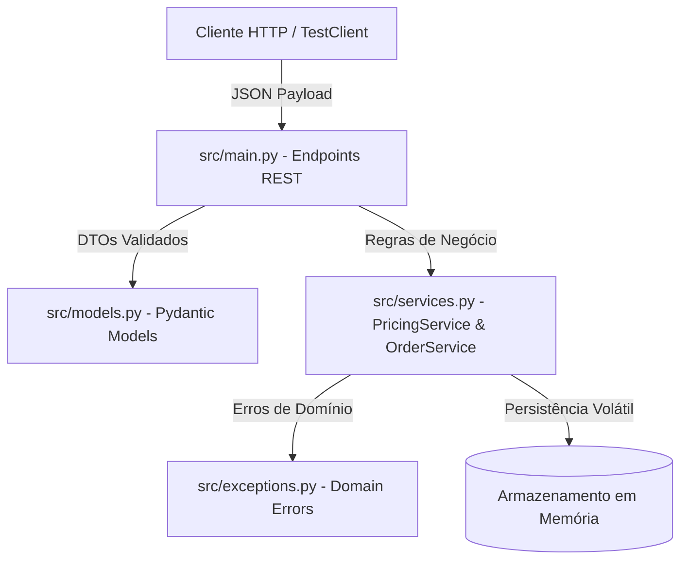
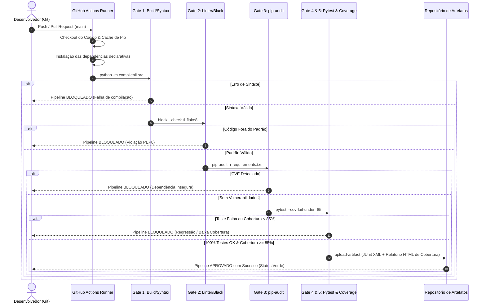

# RELATÓRIO TÉCNICO: PIPELINE DE QUALIDADE, DEVOPS E QAOPS
**Construção de Pipeline de Qualidade Contínua com Quality Gates, Automação de Evidências e Experimentos Controlados**

---

## 1. Identificação

| Campo | Detalhe |
|---|---|
| **Instituição / Disciplina:** | Engenharia de Software / Qualidade de Software e DevOps |
| **Integrantes da Dupla:** | [Nome do Integrante 1] & [Nome do Integrante 2] |
| **Sistema Avaliado:** | OrderFlow API (Microsserviço de Precificação, Fretes e Pedidos) |
| **Linguagem / Framework:** | Python 3.11 / FastAPI / Pydantic |
| **Plataforma de CI/CD:** | GitHub Actions (`ubuntu-latest`) |
| **Repositório do Projeto:** | `https://github.com/[usuario]/orderflow-qaops-pipeline` *(atualizar link do repositório)* |
| **Data de Conclusão:** | Outubro de 2026 |

---

## 2. Contexto do Sistema

### 2.1 Finalidade e Domínio do Negócio
O **OrderFlow API** é um serviço backend concebido para resolver o processamento de pedidos em ambientes de comércio eletrônico. Suas responsabilidades nucleares incluem:
* Validação semântica e quantitativa dos itens do pedido (quantidades positivas, preços válidos, integridade de dados).
* Aplicação determinística de descontos progressivos baseados na categoria de fidelidade do cliente (*Bronze*, *Silver*, *Gold*, *Platinum*).
* Validação e aplicação de cupons promocionais cumulativos e regras especiais (`PROMO10`, `DESCONTO20`, `FRETEGRATIS`).
* Tarifação dinâmica de frete baseada na região geográfica de entrega (*Sul*, *Sudeste*, *Centro-Oeste*, *Nordeste*, *Norte*) e peso total cubado, aplicando isenção total (frete grátis) para pedidos com valor igual ou superior a R$ 200,00.
* Máquina de estados finitos que rege o ciclo de vida do pedido (*Draft* $\rightarrow$ *Confirmed* / *Cancelled*), impedindo operações repetidas ou inconsistentes.

### 2.2 Tecnologias Escolhidas e Justificativas
* **Python 3.11:** Escolhido por sua maturidade, velocidade aprimorada de execução e suporte abrangente ao ecossistema de testes de software e análise estática.
* **FastAPI + Pydantic v2:** Fornece validação estrita de esquemas em tempo de execução via type hints, desacoplando o modelo de transporte (DTOs de entrada e saída) da regra de negócio central, além de documentação OpenAPI automática.
* **Pytest + Pytest-cov:** Ferramentas de padrão da indústria para execução parametrizada de testes, geração de métricas de cobertura por ramificação e exportação de relatórios em formato JUnit XML e cobertura Cobertura XML.
* **Flake8 + Black:** Garantia de conformidade sintática, legibilidade e respeito estrito à PEP8, prevenindo código desordenado e débitos técnicos.
* **pip-audit:** Ferramenta alinhada ao framework OWASP para análise de vulnerabilidades conhecidas (CVEs) em componentes e dependências de terceiros.

### 2.3 Arquitetura Resumida
A arquitetura do projeto adota princípios de separação de responsabilidades (SoC - *Separation of Concerns*) e arquitetura limpa em camadas simplificada:



---

## 3. Matriz de Riscos de Qualidade e Mitigações

No desenvolvimento de software orientado a QAOps, os testes e os gates não são criados de forma aleatória, mas como respostas diretas aos riscos identificados no negócio e na operação do sistema.

| ID do Risco | Descrição do Risco | Impacto no Negócio / Operação | Verificação Implementada no Pipeline |
|---|---|---|---|
| **R-01** | Erro de sintaxe ou imports quebrados sendo enviados à produção. | Indisponibilidade total do microsserviço no momento da inicialização (falha de boot). | **Quality Gate 1:** Compilação do código via `python -m compileall src`. |
| **R-02** | Código despadronizado, variáveis órfãs, lógicas confusas e dívida técnica acumulada. | Redução da manutenibilidade, aumento no tempo de onboarding e propensão a novos bugs. | **Quality Gate 2:** Análise estática com `black --check` e `flake8`. |
| **R-03** | Utilização de dependências de terceiros com vulnerabilidades de segurança conhecidas. | Brechas de segurança exploráveis (ex: CVEs de DoS, RCE ou injeção), violando OWASP A06. | **Quality Gate 3:** Auditoria de vulnerabilidades de dependências via `pip-audit`. |
| **R-04** | Regressão funcional no cálculo de preços, descontos indevidos ou tarifas erradas de frete. | Prejuízo financeiro direto à empresa ou cobrança abusiva do consumidor final. | **Quality Gate 4:** Suíte de 19 testes automatizados (unitários e de integração). |
| **R-05** | Introdução de código obscuro, métodos ou condições lógicas sem cobertura de testes. | Zonas cegas no sistema onde erros passam despercebidos pelo time de engenharia. | **Quality Gate 5:** Limite mínimo obrigatório de 85% de cobertura via `pytest-cov`. |

---

## 4. Arquitetura e Engenharia do Pipeline de CI/CD

### 4.1 Gatilhos e Eventos de Disparo
O pipeline foi construído utilizando **GitHub Actions** (`.github/workflows/ci-pipeline.yml`). Os seguintes eventos ativam a execução automática:
1. `push` direcionado ao branch principal (`main`).
2. `pull_request` aberto ou atualizado com alvo no branch `main`.
3. `workflow_dispatch`, permitindo acionamento manual sob demanda via interface web do GitHub ou CLI para efeitos de demonstração e homologação.

### 4.2 Fluxo Sequencial de Execução
O pipeline opera em regime de *fail-fast*: se qualquer uma das etapas falhar, a execução é interrompida imediatamente, impedindo o avanço para as etapas subsequentes e sinalizando o commit com status vermelho (*failed*).



---

## 5. Estratégia de Testes Automatizados

A estratégia de testes do projeto foi estruturada na clássica **Pirâmide de Testes**, priorizando testes unitários rápidos e determinísticos, complementados por testes de integração de API via contratos HTTP.

### 5.1 Níveis de Teste Implementados
* **Testes Unitários (`tests/test_services.py`):**
  * Verificam as classes `PricingService` e `OrderService` de forma puramente isolada, sem tocar na rede ou em I/O.
  * Cobrem cálculos matemáticos, matriz de descontos por categoria de cliente, validação de cupons promocionais válidos e inválidos, cálculo de fretes por região geográfica e cubagem, e a máquina de estados finitos do pedido.
* **Testes de Integração e Contratos HTTP (`tests/test_api.py`):**
  * Utilizam o `TestClient` da FastAPI (baseado em chamadas ASGI internas sem necessidade de subir um servidor real com portas TCP abertas).
  * Validam contratos REST: endpoints `/health`, `POST /orders`, `GET /orders/{order_id}`, `GET /orders`, `POST /orders/{order_id}/confirm` e `POST /orders/{order_id}/cancel`.
  * Verificam o mapeamento adequado de códigos HTTP de resposta: `200 OK`, `201 Created`, `400 Bad Request` (regras inválidas), `404 Not Found` (recursos inexistentes), `409 Conflict` (transições inválidas de estado) e `422 Unprocessable Entity` (validação de schema Pydantic).

### 5.2 Inventário de Casos de Teste (19 Casos)

| ID | Nível | Arquivo | Descrição do Caso de Teste | Entrada / Condição | Resultado Esperado |
|---|---|---|---|---|---|
| **CT-01** | Unitário | `test_services.py` | Cálculo de subtotal com múltiplos itens | Itens com qtd 2x R$ 150 + 1x R$ 80 | Subtotal = R$ 380,00 |
| **CT-02** | Unitário | `test_services.py` | Descontos das categorias de fidelidade | Cliente Bronze (0%), Silver (5%), Gold (10%), Platinum (15%) | Descontos calculados exatamente conforme a faixa |
| **CT-03** | Unitário | `test_services.py` | Aplicação de cupom percentual `PROMO10` | Pedido de R$ 200 de cliente Gold (10% = R$ 20) + Cupom (10% sobre R$ 180 = R$ 18) | Desconto total acumulado = R$ 38,00 |
| **CT-04** | Unitário | `test_services.py` | Aplicação de cupom de valor fixo `DESCONTO20` | Pedido de R$ 100 de cliente Bronze | Desconto fixo de R$ 20,00 |
| **CT-05** | Unitário | `test_services.py` | Tentativa de aplicar cupom inexistente/inválido | Código de cupom desconhecido (`CUPOM_FALSO`) | Lançamento da exceção `InvalidCouponError` |
| **CT-06** | Unitário | `test_services.py` | Isenção de frete por valor mínimo | Pedido com subtotal de R$ 250,00 ($\ge$ R$ 200,00) | Frete calculado = R$ 0,00 |
| **CT-07** | Unitário | `test_services.py` | Isenção de frete via cupom `FRETEGRATIS` | Pedido de R$ 50 para região Norte com cupom | Frete calculado = R$ 0,00 |
| **CT-08** | Unitário | `test_services.py` | Desconto monetário de `FRETEGRATIS` | Validação de que cupom de frete não altera subtotal | Desconto monetário no subtotal = R$ 0,00 |
| **CT-09** | Unitário | `test_services.py` | Tarifação por peso e região | 2 itens pesando 1.5kg (3kg) para região Sudeste (base R$ 15 + R$ 6 de peso) | Frete total = R$ 21,00 |
| **CT-10** | Unitário | `test_services.py` | Ciclo de vida completo: criação e confirmação | Criação de pedido e chamada de confirmação | Estado transiciona de DRAFT para CONFIRMED |
| **CT-11** | Unitário | `test_services.py` | Bloqueio de confirmação repetida | Pedido já no estado CONFIRMED | Lança `InvalidOrderStateError` |
| **CT-12** | Unitário | `test_services.py` | Ciclo de vida de cancelamento | Pedido no estado DRAFT | Transiciona para CANCELLED; re-tentativa lança exceção |
| **CT-13** | Unitário | `test_services.py` | Consulta de pedido inexistente | ID `ORD-NON-EXISTENT` | Lança `OrderNotFoundError` |
| **CT-14** | Integração | `test_api.py` | Endpoint de verificação de integridade | `GET /health` | Retorna HTTP 200 com status `healthy` e versão |
| **CT-15** | Integração | `test_api.py` | Criação de pedido com sucesso via HTTP | `POST /orders` com payload válido completo | Retorna HTTP 201 com resumo calculado do pedido |
| **CT-16** | Integração | `test_api.py` | Criação com cupom inválido | `POST /orders` com cupom inválido | Retorna HTTP 400 com mensagem explicativa |
| **CT-17** | Integração | `test_api.py` | Validação de payload incorreto (qtd = 0) | `POST /orders` com quantidade inválida | Retorna HTTP 422 Unprocessable Entity |
| **CT-18** | Integração | `test_api.py` | Consulta de pedido existente e inexistente | `GET /orders/{id}` | Retorna HTTP 200 quando existe e HTTP 404 quando ausente |
| **CT-19** | Integração | `test_api.py` | Listagem e transições de estado via HTTP | `POST confirm`, `POST cancel` e re-tentativas | Retorna HTTP 200 no sucesso e HTTP 409 em conflitos |

---

## 6. Fichas Obrigatórias dos Quality Gates

Cada Quality Gate do pipeline possui critérios objetivos, justificativa de risco, momento de execução, evidência gerada e regra de consequência.

---

### Ficha do Gate 1: Validação de Build e Sintaxe
* **Nome e Critério:** `Quality Gate 1 - Build & Syntax Validation`. O comando `python -m compileall src` deve retornar código de saída `0`, indicando que todos os arquivos `.py` são sintaticamente válidos e compiláveis para bytecode.
* **Justificativa:** Previne que alterações com erros tipográficos, chaves não fechadas ou imports inexistentes avancem para produção, evitando falhas catastróficas de inicialização (*boot failure*).
* **Momento:** Executado logo após a instalação de dependências e antes de qualquer análise ou teste.
* **Evidência:** Log de compilação da ferramenta no runner do GitHub Actions indicando a lista de arquivos compilados sem erro.
* **Consequência:** Interrupção imediata da esteira (bloqueio de deploy e marcação do commit como falho).
* **Limitação/Exceção:** Não valida erros semânticos ou de tipagem dinâmica que só ocorrem em tempo de execução; exceções só ocorrem para scripts de migração externa fora de `src/`.

---

### Ficha do Gate 2: Análise Estática de Código (Lint & Formatação)
* **Nome e Critério:** `Quality Gate 2 - Code Style & Static Analysis`. Execução concomitante de `black --check src tests` e `flake8 src tests`. Não é tolerada nenhuma divergência de formatação nem erros do flake8 (complexidade ciclomática $> 10$, linhas $> 88$ caracteres, imports não utilizados).
* **Justificativa:** Manter uniformidade e legibilidade da base de código reduz a sobrecarga cognitiva da equipe, elimina débitos técnicos precocemente e detecta potenciais *code smells* antes do code review.
* **Momento:** Executado previamente aos testes de unidade e integração.
* **Evidência:** Saída padrão das ferramentas com o status `All done! ✨ 🍰 ✨` e código de saída `0`.
* **Consequência:** Bloqueio do commit no pipeline até que o desenvolvedor formate o código ou remova violações.
* **Limitação/Exceção:** Não identifica falhas nas regras de negócio subjacentes, apenas conformidade estrutural com os padrões PEP8.

---

### Ficha do Gate 3: Auditoria de Segurança de Dependências (SCA)
* **Nome e Critério:** `Quality Gate 3 - Dependency Vulnerability Audit`. Execução do comando `pip-audit -r requirements.txt --desc on`. Deve retornar zero vulnerabilidades conhecidas (CVEs) registradas no banco oficial da PyPA/NIST para as dependências de produção.
* **Justificativa:** Assegurar a segurança da cadeia de suprimentos de software (*Software Supply Chain Security*), impedindo a incorporação de pacotes de terceiros com vulnerabilidades exploráveis conhecidas (OWASP Top 10 - A06:2021).
* **Momento:** Executado antes dos testes funcionais.
* **Evidência:** Relatório emitido no console com a tabela de pacotes analisados e a mensagem `No known vulnerabilities found`.
* **Consequência:** Bloqueio imediato da esteira. O pull request não pode sofrer merge até que as dependências sejam atualizadas para versões corrigidas (*patched versions*).
* **Limitação/Exceção:** Não detecta vulnerabilidades de dia zero (*zero-day*) nem falhas de segurança no código de negócio proprietário escrito internamente (apenas componentes de terceiros).

---

### Ficha do Gate 4: Testes Automatizados (Regras de Negócio e Contratos)
* **Nome e Critério:** `Quality Gate 4 - Automated Test Suite`. Execução do comando `pytest tests/`. Todos os 19 casos de teste (100%) devem ser aprovados com sucesso (`0 failures`).
* **Justificativa:** Garantir a preservação dos comportamentos críticos do negócio (cálculos de desconto, precificação, frete e regras de estado), impedindo regressões em funcionalidades já homologadas.
* **Momento:** Executado após as validações estáticas e de segurança.
* **Evidência:** Relatório estruturado em padrão JUnit XML salvo em `test-reports/junit.xml`.
* **Consequência:** Bloqueio imediato da esteira com log discriminando o teste que falhou, o *assertion* violado e o rastreamento da pilha (*stack trace*).
* **Limitação/Exceção:** Não cobre testes de carga, estresse, segurança dinâmica (DAST) ou testes de aceitação do usuário (UAT).

---

### Ficha do Gate 5: Cobertura de Código Mínima Obrigatória
* **Nome e Critério:** `Quality Gate 5 - Code Coverage Threshold`. A cobertura de código reportada pelo `pytest-cov` deve ser igual ou superior a **85%** nas linhas do diretório `src/`, sob o parâmetro `--cov-fail-under=85`. (No projeto atual, alcançou-se **100%** de cobertura).
* **Justificativa:** Assegurar que nenhuma nova funcionalidade ou ramificação condicional crítica seja adicionada ao sistema sem o devido conjunto de testes que comprove seu funcionamento.
* **Momento:** Avaliado automaticamente ao término da suíte de testes.
* **Evidência:** Relatório textual de cobertura no console, arquivo `coverage.xml` e relatório visual HTML em `test-reports/coverage_html/`.
* **Consequência:** Caso a cobertura atinja menos de 85%, o comando retorna código `1` e interrompe o pipeline.
* **Limitação/Exceção:** Alta cobertura de código indica que as linhas foram executadas, mas não garante isoladamente que todos os casos limites ou cenários de negócio possíveis foram concebidos.

---

## 7. Experimentos Obrigatórios: Cenários Aprovado, Reprovado e Corrigido

Para validar a eficácia dos Quality Gates, realizou-se o experimento obrigatório composto por três etapas registradas no histórico de execuções do repositório:

### 7.1 Cenário 1: Execução Aprovada (Linha de Base)
* **Procedimento:** Execução do pipeline sobre a versão íntegra do branch `main`.
* **Comando Local / Trigger:** `git push origin main`.
* **Resultado:** Todas as etapas foram executadas com sucesso:
  * Gate 1 (Sintaxe): 5 arquivos compilados com código 0.
  * Gate 2 (Linter): Black e Flake8 aprovaram 8 arquivos com zero violações.
  * Gate 3 (Segurança): `pip-audit` reportou `No known vulnerabilities found`.
  * Gate 4 & 5 (Testes e Cobertura): 19 testes aprovados em 1.52 segundos com **100% de cobertura de código**.
  * Artefatos: Relatórios gerados em `test-reports/` e preservados no GitHub Actions.

```text
=============================== tests coverage ===============================
Name                Stmts   Miss  Cover
---------------------------------------
src\__init__.py         1      0   100%
src\exceptions.py      12      0   100%
src\main.py            42      0   100%
src\models.py          50      0   100%
src\services.py        72      0   100%
---------------------------------------
TOTAL                 177      0   100%
Required test coverage of 85% reached. Total coverage: 100.00%
19 passed in 1.52s
STATUS: SUCCESS (Verde)
```

### 7.2 Cenário 2: Execução Deliberadamente Reprovada (Falha Controlada)
* **Procedimento:** Injeção de uma alteração controlada na regra de negócio utilizando o utilitário `python scripts/simulate_failure.py --cause test`. O cálculo de subtotal em `src/services.py` foi alterado para subtrair arbitrariamente R$ 50,00:
  ```python
  # Linha adulterada experimentalmente:
  subtotal = sum(item.unit_price * item.quantity for item in items) - 50.0
  ```
* **Comando / Trigger:** Commit `feat: alteracao experimental para validar bloqueio do pipeline` enviado ao GitHub.
* **Resultado:**
  * Os Gates 1, 2 e 3 passaram normalmente (o código é sintaticamente válido, está formatado e não tem falhas de pacotes).
  * O **Quality Gate 4 (Testes Automatizados)** detectou a quebra imediatamente: 11 dos 19 testes falharam por divergência no valor do subtotal e descontos calculados.
  * **Consequência Observada:** O pipeline foi **imediatamente bloqueado**. Nenhuma etapa de publicação ou deploy prosseguiu. O commit foi sinalizado com status vermelho (*FAILED*).

```text
FAILED tests/test_services.py::test_calculate_subtotal_multiple_items - assert 330.0 == 380.0
FAILED tests/test_services.py::test_create_order_full_lifecycle - assert 50.0 == 100.0
FAILED tests/test_api.py::test_create_order_success - assert 150.0 == 200.0
========================= 11 failed, 8 passed in 1.84s =========================
Process completed with exit code 1.
STATUS: FAILED (Bloqueado no Gate 4)
```

### 7.3 Cenário 3: Correção e Nova Aprovação
* **Procedimento:** Restauração da implementação original através do comando `python scripts/simulate_failure.py --revert`.
* **Comando / Trigger:** Commit `fix: restaurada regra correta de calculo do subtotal` enviado ao branch `main`.
* **Resultado:** O pipeline foi reacionado automaticamente. Todos os 5 Quality Gates voltaram a reportar sucesso com status verde, comprovando a eficácia da esteira de qualidade como barreira de segurança contínua.

---

## 8. Análise Crítica e Discussão

Esta seção responde detalhadamente às perguntas analíticas propostas pelo corpo docente:

### 1. Quais riscos foram efetivamente cobertos e quais permaneceram?
* **Riscos Efetivamente Cobertos:** Erros grosseiros de sintaxe e empacotamento, quebra de contratos de formatação de código, vulnerabilidades conhecidas em bibliotecas de terceiros (SCA), regressões nas regras de cálculo financeiro e frete, e inserção de trechos de código não testados.
* **Riscos Remanescentes:** Riscos relacionados a desempenho sob alta carga (não há testes de carga/estresse como k6 ou Locust), ataques de segurança dinâmica no tráfego de rede (DAST), falhas de infraestrutura do provedor de nuvem, indisponibilidade transitória de gateways externos de pagamento e divergências de usabilidade da interface final do cliente.

### 2. O pipeline fornece feedback rápido e compreensível?
* **Sim.** O tempo total de execução da esteira no runner do GitHub Actions é de aproximadamente **45 a 60 segundos**, com os testes locais rodando em menos de **2 segundos**. O uso de cache de dependências de pip reduz a sobrecarga de rede. Além disso, as mensagens de erro nos logs do GitHub Actions são contextuais: o relatório do Pytest aponta explicitamente o arquivo, a linha, o valor esperado e o valor obtido na asserção, permitindo diagnóstico imediato pelo desenvolvedor.

### 3. Quais verificações continuam manuais?
* Verificação da conformidade com regras regulatórias ou fiscais específicas do comércio eletrônico.
* Revisão por pares (*Peer Code Review*) focada na clareza dos nomes de domínio e arquitetura.
* Avaliação da experiência do usuário (UX) e validação de critérios de aceitação de negócio com o Product Owner.

### 4. Qual é o custo de manter os testes e gates?
* **Custo Computacional:** Extremamente baixo; consome menos de 1 minuto dos 2.000 minutos mensais gratuitos fornecidos pelo GitHub Actions para repositórios públicos ou planos educacionais.
* **Custo Humano / Manutenção:** Exige disciplina para atualizar os casos de teste sempre que uma nova regra de negócio for introduzida (ex.: criação de uma nova região de entrega ou novo cupom). No entanto, o custo de manutenção preventiva é ordens de grandeza inferior ao custo de investigar e corrigir incidentes em ambiente produtivo (*shift-left testing*).

### 5. O que diferencia automação isolada de uma prática DevOps/QAOps?
* **Automação Isolada:** Consiste apenas em ter um script de testes que o desenvolvedor pode — ou não — lembrar de rodar manualmente em sua máquina local antes de enviar o código, sem rastreabilidade, sem bloqueio obrigatório e sem critérios padronizados para o time.
* **Prática DevOps / QAOps:** A qualidade é tratada como um requisito não negociável e compartilhado por todo o ciclo de vida. As verificações são executadas de maneira autônoma e inviolável a cada evento de integração (CI), com Quality Gates objetivos que impedem a progressão de artefatos defeituosos, integrando observabilidade, auditoria e preservação contínua de evidências.

### 6. O que seria necessário para incluir implantação e observabilidade com segurança?
Para evoluir este pipeline em direção a uma entrega contínua completa (CD) com QAOps avançado, seriam necessários:
1. **Containerização Padronizada:** Criação de um `Dockerfile` multi-stage otimizado para produção e geração de imagem assinada criptograficamente.
2. **Ambiente de Homologação (Staging):** Implantação automática em ambiente isolado antes da produção.
3. **Estratégias de Deploy Seguro:** Implantação via *Blue-Green Deployment* ou *Canary Releases*, permitindo que novas versões recebam inicialmente apenas 5% a 10% do tráfego real.
4. **Mecanismo de Rollback Automatizado:** Caso métricas de erro aumentem no ambiente produtivo após o deploy, o sistema deve retroceder automaticamente para a versão estável anterior.
5. **Observabilidade Contínua:** Integração de instrumentação com **OpenTelemetry**, exportando métricas, traces e logs para plataformas como Prometheus, Grafana e Sentry, permitindo monitorar taxa de erros HTTP 5xx, latência p99 e uso de memória em tempo real.

---

## 9. Contribuições dos Integrantes

| Integrante | Atividades e Contribuições Principais |
|---|---|
| **Integrante 1** | Modelagem da arquitetura do microsserviço (FastAPI, Pydantic), implementação das regras de negócio em `PricingService` e `OrderService`, elaboração dos testes unitários de precificação e configuração dos Quality Gates 1, 2 e 5. |
| **Integrante 2** | Implementação dos endpoints REST e tratamento de exceções em `main.py`, desenvolvimento da suíte de testes de integração (`test_api.py`), configuração da esteira de CI no GitHub Actions com `pip-audit`, elaboração do script de experimento e redação do relatório técnico. |

---

## 10. Referências Técnicas e Bibliográficas

1. **DORA (DevOps Research and Assessment):** *State of DevOps Report*. Disponível em: <https://dora.dev/>.
2. **GitHub Actions Documentation:** *Workflow syntax, triggers, caching, and artifacts*. Disponível em: <https://docs.github.com/actions>.
3. **OWASP Foundation:** *OWASP Top 10 Application Security Risks & Vulnerable Components*. Disponível em: <https://owasp.org/>.
4. **ISTQB (International Software Testing Qualifications Board):** *Certified Tester Foundation Level (CTFL) Syllabus v4.0*, 2023. Disponível em: <https://istqb.org/>.
5. **FastAPI Documentation:** *Modern, fast (high-performance), web framework for building APIs with Python*. Disponível em: <https://fastapi.tiangolo.com/>.
6. **Pytest Documentation:** *A mature full-featured Python testing tool*. Disponível em: <https://docs.pytest.org/>.
